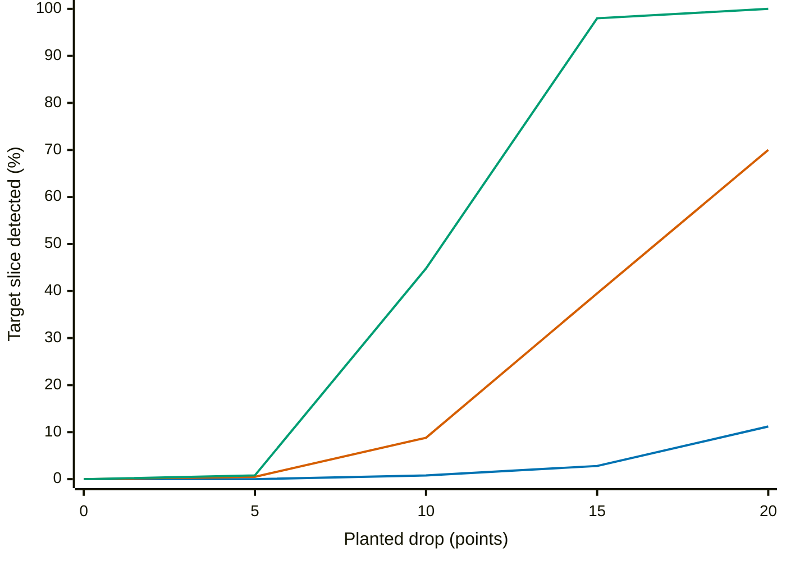

# Seeded regression detection

Reproduce this report with `uv run python tools/benchmark.py --write`.
Check the committed report with `uv run python tools/benchmark.py --check`.

## Protocol

Each row uses 400 simulated checks with seed 19. Each check tests 3 independent gate slices with the same paired sample size. The baseline succeeds with probability 80%. Unchanged versions disagree on 10% of pairs, with equal probabilities of a fix and a break.

The mutation converts some pairs that both succeeded into baseline-only successes in one slice. A ten-point planted drop subtracts ten points from that slice's population success rate and increases its disagreement by the same amount. The other slices use the unchanged population.

The gate uses its Tango interval at 95% confidence and a tolerance of 5 points. The shipped Holm rule controls regression calls across the family. The zero-drop rows measure the observed family false-alarm rate. A change exactly at the tolerance is on the decision boundary. The target column counts how often the planted slice itself was called regressed. Rows reuse the same seed for reproducibility.

| Pairs per slice | Planted drop (points) | Target slice detected | Any slice flagged |
| ---: | ---: | ---: | ---: |
| 25 | 0 | 0.0% | 0.0% (False alarm) |
| 25 | 5 | 0.0% | 0.0% |
| 25 | 10 | 0.8% | 0.8% |
| 25 | 15 | 2.8% | 2.8% |
| 25 | 20 | 11.2% | 11.2% |
| 50 | 0 | 0.0% | 0.0% (False alarm) |
| 50 | 5 | 0.2% | 0.2% |
| 50 | 10 | 4.0% | 4.0% |
| 50 | 15 | 15.8% | 15.8% |
| 50 | 20 | 36.8% | 36.8% |
| 100 | 0 | 0.0% | 0.0% (False alarm) |
| 100 | 5 | 0.5% | 0.5% |
| 100 | 10 | 8.8% | 8.8% |
| 100 | 15 | 39.5% | 39.5% |
| 100 | 20 | 70.0% | 70.0% |
| 200 | 0 | 0.0% | 0.0% (False alarm) |
| 200 | 5 | 0.2% | 0.2% |
| 200 | 10 | 23.2% | 23.2% |
| 200 | 15 | 74.5% | 74.5% |
| 200 | 20 | 96.8% | 96.8% |
| 400 | 0 | 0.0% | 0.0% (False alarm) |
| 400 | 5 | 0.8% | 0.8% |
| 400 | 10 | 44.8% | 44.8% |
| 400 | 15 | 98.0% | 98.0% |
| 400 | 20 | 100.0% | 100.0% |

## Detection curves

The blue, orange and teal lines represent 25, 100 and 400 pairs per slice, respectively.



## Plan a slice

```sh
evalgate power --size 100 --baseline-rate 0.80 --discordance 0.10 --tolerance 0.05 --gate-slices 3
```

Use the slice's paired size and baseline score. Estimate unchanged discordance from paired reruns of the same version. The command reports the first drop on its grid whose observed detection reaches the requested target. Rates near that threshold can vary with the seed or draw count. A thin slice may have no detectable drop under the specified model.

These are synthetic scorer-level perturbations. Prompt edits, model switches and dependent real slices can have different disagreement and detection rates. A zero observed false-alarm count is subject to finite simulation uncertainty. The benchmark makes zero model calls.
